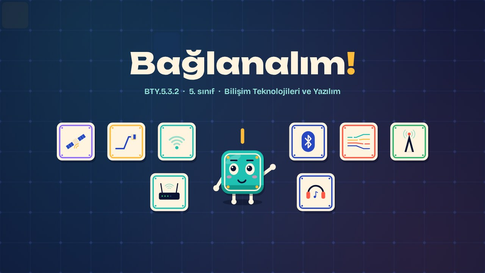
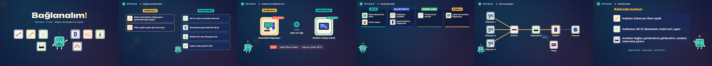

# Bağlanalım! · Let's Connect!

**▶ Tarayıcıda izleyin / Watch in the browser:** https://hakanatas.github.io/baglanalim/ 
**⬇ MP4 + altyazılar / MP4 + subtitles:** [Releases](https://github.com/hakanatas/baglanalim/releases) 
**✎ Kullanılan istem / The prompt behind it:** [PROMPT.md](PROMPT.md) 
**🎞 Bütün filmler / All films:** [Bilişim Filmleri](https://hakanatas.github.io/bilisim-filmleri/?sinif=5)

> **TR —** 5. sınıf Bilişim Teknolojileri ve Yazılım dersinin "Bilgisayar Ağları ve İletişim" temasındaki BTY.5.3.2 öğrenme çıktısı için hazırlanmış, tamamen JavaScript ile çizilen 2,1 dakikalık animasyon; ses efektleri ve hafif fon müziği de kodla üretilir. Ağlara bağlanma yöntemleri kablolu (Ethernet, fiber optik) ve kablosuz (Wi-Fi, Bluetooth, mobil veri, uydu) olarak ayrılır. Kablolu ve kablosuz bağlantının güçlü ve zayıf yanları karşılaştırılır. Günlük hayattaki cihazlar kullandıkları bağlantı teknolojisiyle eşleştirilir. Son olarak okuldaki bir ağda anahtar (switch), yönlendirici ve modemin işlevleri veri paketleriyle izlenir. Altyazılar Türkçe, İngilizce ya da ikisi birlikte seçilebilir.

A 2.1-minute animation, with code-generated sound, for **5th-grade IT and Software** (Türkiye Yüzyılı Maarif Modeli). Connection methods are split into wired (Ethernet, fibre) and wireless (Wi-Fi, Bluetooth, mobile data, satellite); wired and wireless are compared; everyday devices are matched to technologies; and the jobs of a switch, router and modem are followed in a school network. The guide is **Karo**, a living glazed tile who never speaks: he tells the story with his face, his arms and the blinking cursor above his head.

## Öğrenme çıktısı · Learning outcome

MEB, Türkiye Yüzyılı Maarif Modeli, Bilişim Teknolojileri ve Yazılım Dersi Öğretim Programı, 5. sınıf, 3. tema "Bilgisayar Ağları ve İletişim":

**BTY.5.3.2. Bilgisayar ağları ve bağlanma yöntemlerini sınıflandırabilme**
- a) Bilgisayar ağlarında kullanılan bağlanma yöntemlerini belirler.
- b) Bilgisayar ağlarında kullanılan bağlanma yöntem ve teknolojilerini ilişkilendirir.
- c) Bilgisayar ağlarında kullanılan bileşenlerin işlevlerini gruplandırır.

## Sahneler · Scenes

| # | Zaman | Sahne | Ne oluyor | Çıktı |
|---|---|---|---|---|
| 1 | 0:00–0:17 | Giriş |  |  |
| 2 | 0:17–0:39 | Bağlanma yöntemleri | Kablolu ve kablosuz bağlanma yöntemleri. | a |
| 3 | 0:39–0:55 | Kablolu mu, kablosuz mu? | Kablolu ve kablosuz bağlantının avantaj ve dezavantajları. | a |
| 4 | 0:55–1:24 | Hangi teknoloji? | Günlük hayattaki cihazlar kullandıkları bağlantı teknolojisiyle eşleştirilir. | b |
| 5 | 1:24–1:50 | Kim ne iş yapar? | Anahtar, yönlendirici ve modemin işlevleri gruplandırılır. | c |
| 6 | 1:50–2:05 | Aklında kalsın |  |  |

## Çalıştırma · Running it

- **Önizleme:** `index.html` dosyasına çift tıklayın (çevrim dışı da çalışır). Klavye: boşluk oynat/duraklat, ← → 3 sn, Home başa. Adrese `?altyazi=en`, `?bicim=vertical` ya da `?ses=0` eklenebilir.
- **MP4:** bir kez `npm install`, sonra `npm run export -- --format=both --captions=tr` (720p yatay ve dikey, sesli). Google Chrome yüklüyse Playwright onu kullanır (`channel: 'chrome'`); ffmpeg gerekir.
- **Altyazı ve seslendirme notları:** `npm run srt` → `out/baglanalim_tr.srt`, `_en.srt`, `_tr-en.srt`, `_seslendirme-notlari.txt`.
- **Sürüm dosyaları:** `npm run release` → `release/` klasöründe v1.0'ın 6 dosyası.
- **Yazı kontrolü:** `npm run check` yatay ve dikey düzende, üç altyazı seçeneğiyle üst üste binen, kenardan taşan ya da 720p'de 17 pikselden küçük kalan yazı arar.
- **Düzenleme:** senaryo (sahneler, altyazılar, seslendirme notları) `scenes/film.js` içindedir; değiştirince `npm run build` süreleri, `captions.js` ve `film.config.js` dosyalarını yeniden üretir. Sahne şablonları `src/kit/`, Karo `src/draw/karo.js`, ses `src/audio/synth.js`.

Her kare `renderFrame(t)` ile zamanın saf fonksiyonu olarak çizilir; rastgelelik tohumludur, MP4 ekran kaydı değil kare kare üretimdir. Ses de dosyadan çalınmaz: aynı olay listesinden hesaplanır. Yazı tipleri: Unbounded ve Bricolage Grotesque (SIL OFL 1.1), dosyaya gömülü.

## Lisans · License

**TR —** Bu film ve kodu [Creative Commons Atıf-GayriTicari 4.0 Uluslararası (CC BY-NC 4.0)](https://creativecommons.org/licenses/by-nc/4.0/deed.tr) lisansıyla paylaşılır. Ticari olmayan her amaçla (derste, okulda, eğitim materyalinde) kopyalayabilir, paylaşabilir ve değiştirebilirsiniz; ancak **kaynak göstermek zorunludur**: eser sahibinin adı ve bu deponun bağlantısı belirtilmeden kullanılamaz. Ticari kullanım (satış, ücretli ürün ya da yayın) için izin alınmalıdır.

**EN —** This film and its code are licensed under [Creative Commons Attribution-NonCommercial 4.0 International (CC BY-NC 4.0)](https://creativecommons.org/licenses/by-nc/4.0/). You may copy, share and adapt them for non-commercial purposes, but **attribution is required**: they may not be used without crediting the author and linking to this repository. Commercial use requires permission.

Atıf örneği / Required credit: *“Bağlanalım!”, Hakan Ataş, Bilişim Filmleri — https://github.com/hakanatas/baglanalim — CC BY-NC 4.0*
